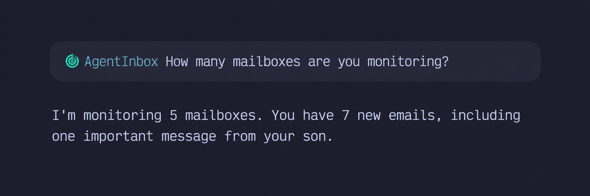
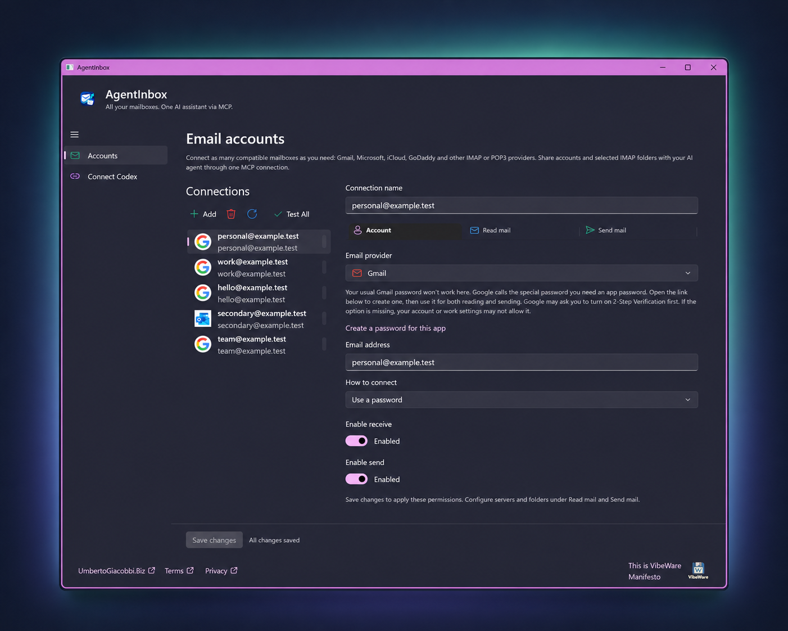
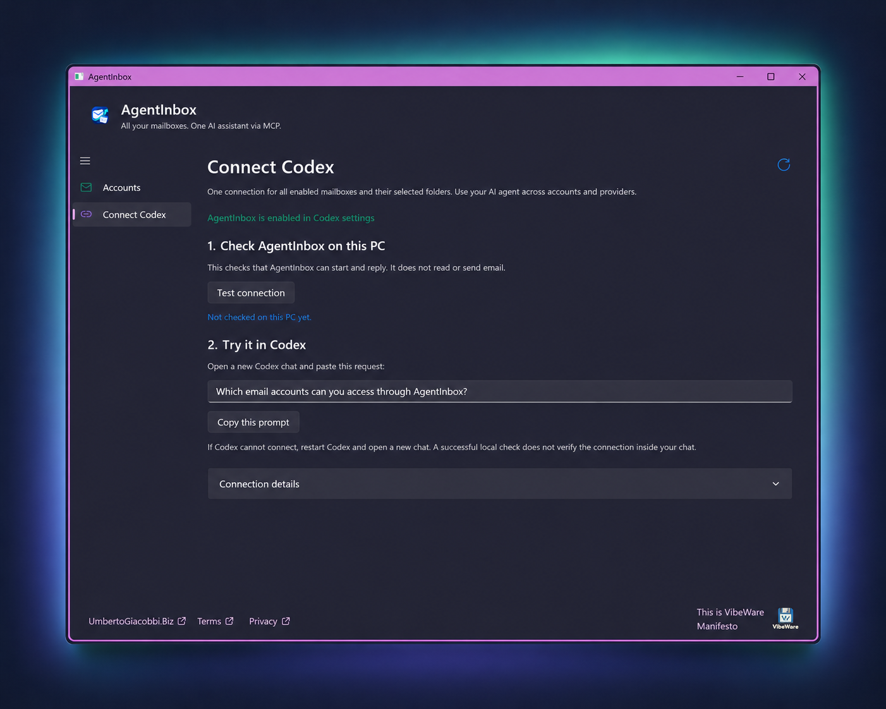

# Connect unlimited mailboxes (Gmail, Microsoft, iCloud, GoDaddy, or custom) to your AI assistant via MCP.

I could connect only one mailbox at a time to my AI assistant. I built AgentInbox so I could use all my mailboxes in the same conversation.

<table align="center">
  <tr>
    <td align="center">
      <a href="docs/assets/promo/conversation-clean-v2/conversation.png">
        
      </a>
      <br>
      <sub>Example conversation. Mailboxes are checked when you ask.</sub>
    </td>
  </tr>
</table>

**[CLI Quick Start (PDF)](docs/AgentInbox-CLI-Quick-Start.pdf)** · [Two-mailbox JSON example](docs/examples/accounts.setup.json) · [Command reference](docs/CLI_REFERENCE.md)

Configure Gmail and Microsoft 365 from your terminal: create local connections, enter an app password securely, sign in with Microsoft and check access. These commands are bundled in the Windows portable Release. See [validation](docs/VALIDATION.md) for the build checks and the provider workflows still to verify.

[](https://github.com/umbertotechnopreneur/AgentInbox/actions/workflows/ci.yml)


[](LICENSE)

Connect as many compatible mailboxes as you need: Gmail, Microsoft, iCloud, GoDaddy and other providers that allow IMAP or POP3 access. Bring personal, work and custom-domain accounts into one conversation through a single local MCP connection.

Let your AI agent work across the accounts and folders you choose, from a few inboxes to dozens of selected IMAP folders across multiple mailboxes. Ask it to find messages across your accounts, read the results or send a message from the account you specify. Reading and sending permissions stay separate for each account.

**[Get started](docs/GETTING_STARTED.md)** · [Account settings](docs/AUTHENTICATION.md) · [Privacy](docs/PRIVACY.md) · [Development](docs/DEVELOPMENT.md)

> **Your assistant may send requested mail to its AI service.** AgentInbox runs locally; the whole conversation may not. Read the [privacy policy](docs/PRIVACY.md) before connecting accounts.

## Two pages to get connected

**Accounts — connect your mailboxes and choose what to share.**

Add and name your connections, follow each provider's sign-in instructions, and choose whether your assistant can read or send mail. Reading and sending are separate permissions. Changes apply when you save; choose server settings and shared folders under **Read mail** and **Send mail**.



**Connect Codex — give your assistant one connection to your enabled accounts.**

Save AgentInbox's connection in Codex, check that the local engine can start and reply, then copy a first request into a new chat. **Connection details** contains manual settings for other local MCP clients. A successful local check does not verify an existing chat connection or mailbox access.



*Styled screenshots based on app captures, with example account data. They illustrate setup; they do not establish provider access or a successful connection check.*

## Bring your mailboxes into one conversation

1. Open **Accounts** in Windows setup and choose **Add** for each mailbox you want to connect.
2. Choose Gmail, iCloud, Microsoft or a custom provider such as GoDaddy, then follow its sign-in instructions.
3. Enable reading and optional sending separately for each account. Use **Test All** to check your saved connections.
4. Open **Connect Codex** for guided setup, or configure another local MCP client manually. One connection exposes the accounts you enable.

Start by asking your assistant:

> Which email accounts can you access through AgentInbox?

Then name the accounts you want it to use:

> Find messages about invoices in my work and personal mailboxes from the past week.

Your mailboxes stay with their providers. AgentInbox gives your assistant tools to search and read the accounts you choose, and to send messages when you request them.

## Gmail, Microsoft, iCloud, GoDaddy and other providers

Choose your **Email provider** to see its instructions and fill in the settings. Gmail and iCloud need a separate password for this app; the setup page links to their instructions. Outlook.com and Microsoft 365 select **Sign in with Microsoft**: press that button, then enter the code on Microsoft's page. Windows setup saves the account settings first. You do not need to enter an app ID or a second password for sending.

| Mail service | Connection requirement |
| --- | --- |
| Gmail | A Google app password; your usual Gmail password will not work here |
| iCloud Mail | An app-specific password |
| GoDaddy and other custom providers | A plan that permits compatible IMAP or POP3 access over TLS, with a password or app password; use the Microsoft preset for Microsoft 365 accounts |
| Outlook.com / Microsoft 365 | Sign in with Microsoft. Outlook settings or your IT team may need to allow mail apps and sending |

Your provider or organization can block access even when the settings are correct. Choosing a Microsoft provider selects **Sign in with Microsoft**. A rejected connection does not change that choice. This app's Microsoft setup still needs a real sign-in check; see [signing in](docs/AUTHENTICATION.md).

IMAP exposes selected server folders and read status. POP3 exposes one mailbox as `INBOX`, has no unread flags or server folders, and searches message headers; its dates come from the email's `Date` header. AgentInbox sends no delete commands; provider retention settings can still affect your mailbox. Connections require TLS or required STARTTLS with certificate and hostname checks; there is no plaintext mode or custom-CA setting.

Choose up to twenty IMAP folders per account. With several mailboxes, your agent can work across dozens of selected folders by searching each account and folder in turn. POP3 gives each connected account one INBOX. There is no fixed mailbox-count limit; local profile size and provider access requirements still apply.

The Windows setup app uses WinUI 3. It keeps incoming mail and optional outgoing mail settings together, with separate connection checks. See [Windows setup](docs/WINDOWS_SETUP.md).

## Send from the account you choose

Sending starts disabled for every account. Enable SMTP only for the accounts you want your assistant to send from. When you request a message, specify the sending account, recipients and content. The `send_email` tool submits immediately, without another confirmation in AgentInbox.

The Windows app only configures connections and permissions. Its SMTP test checks connection and sign-in without sending. A successful send result means the server accepted the message, not that the recipient received it. Unresolved sends are never retried automatically.

## One local MCP connection for your enabled accounts

Your assistant lists your enabled accounts and calls the mail tools for each account you want it to use. It can work with several mailboxes in the same conversation. The Python engine runs locally, using IMAP or POP3 for reading and optional SMTP for sending. It does not need a .NET backend.

Source entry point:

```text
python -B python/run.py mcp
```

Use an absolute interpreter path and an absolute path to `python/run.py` in your MCP client. See [connection setup](docs/CODEX_SETUP.md) and the [tool contract](docs/MCP_CONTRACT.md).

The Windows app guides you through connecting Codex. For another assistant, configure its local MCP connection manually using the same account profile.

## Where it runs

- **Windows 11 x64 and ARM64:** native WinUI 3 setup; portable Release ZIPs on [GitHub Releases](https://github.com/umbertotechnopreneur/AgentInbox/releases), with separate MSIX distribution for the Microsoft Store. Extract the whole ZIP and open `AgentInbox.Desktop.exe`. Settings stay in your Windows user profile.
- **Linux and macOS:** Python source only, for users who can configure and adapt it. No compiled distributions or commercial support are provided. Contributor pull requests with fixes are welcome.

The engine requires Python 3.11 or newer and uses the standard library. On Windows, passwords and Microsoft refresh tokens use Windows Credential Manager; temporary sign-in blobs use current-user DPAPI. There is no plain-text credential fallback. See [dependencies](docs/DEPENDENCIES.md).

## Explore the project

- [Getting started](docs/GETTING_STARTED.md)
- [Accounts and passwords](docs/AUTHENTICATION.md)
- [Connection troubleshooting](docs/RECOVERY.md)
- [MCP tools](docs/MCP_CONTRACT.md)
- [Architecture](docs/ARCHITECTURE.md)
- [Build and contribute](docs/DEVELOPMENT.md)
- [Privacy](docs/PRIVACY.md) and [terms](docs/TERMS.md)

[MIT license](LICENSE). [Contributions](CONTRIBUTING.md) and [security reports](SECURITY.md) are welcome. Independent project; no provider or assistant vendor endorsement is implied.

<a id="external-binary-security-policy"></a>

## A note on security

I care about what goes into this project. Before I add a third-party library or prebuilt binary, including files supplied without source code, I scan the downloaded package, its extracted files and any dependencies with Microsoft Windows Defender. I keep new imports aside until the scan finishes without detections.

I keep a record of where each new import came from and the scan result. If a scan cannot finish or flags something, I leave it out.

---

## VibeWare

AgentInbox participates in [VibeWare](https://umbertogiacobbi.biz/vibeware/manifesto), my open initiative for software built with AI under human direction. I define what the app should do, guide the work and take responsibility for checking the result. The mark describes this approach; the [validation record](docs/VALIDATION.md) shows what has actually been checked. You can explore and reuse the open-source materials under their licenses.

[Terms](https://umbertogiacobbi.biz/agentinbox/terms/) · [Privacy](https://umbertogiacobbi.biz/agentinbox/privacy/)

<p align="right">
  <a href="https://umbertogiacobbi.biz/vibeware/manifesto">
    
  </a><br>
  <em>Human intent, AI execution, and plenty of tokens</em>
</p>
