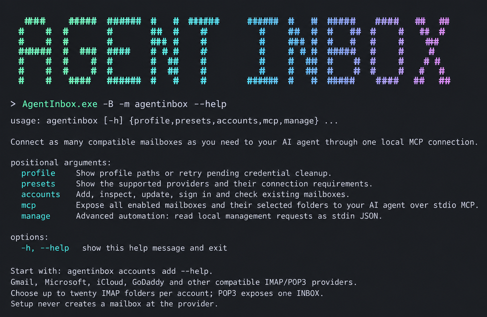
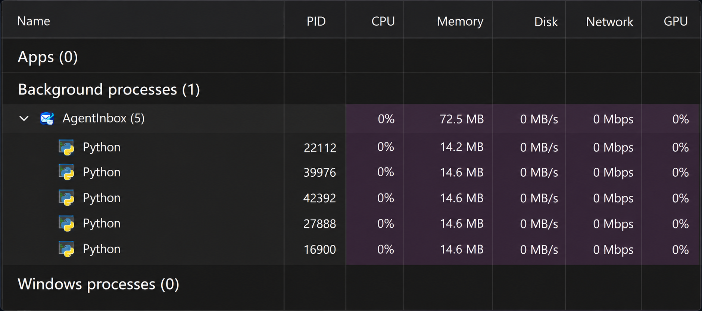

# AgentInbox

**All your mailboxes. One AI conversation.**

My email was spread across several accounts. I built AgentInbox so I could ask my assistant about all of them at once.

<table align="center">
  <tr>
    <td align="center">
      
       
      Example conversation. Mailboxes are checked when you ask.
    </td>
  </tr>
</table>

**[Download for Windows](https://github.com/umbertotechnopreneur/AgentInbox/releases)** · **[Setup guide](docs/GETTING_STARTED.md)** · [Privacy](docs/PRIVACY.md)

Connect as many compatible mailboxes as you need: Gmail, Microsoft, iCloud, GoDaddy and other IMAP or POP3 providers. One MCP connection lets your AI assistant work across them.

## Get started

1. Download the Windows ZIP, extract the whole folder and open `AgentInbox.Desktop.exe`.
2. Add your mailboxes. Choose which accounts and folders to share.
3. Connect your assistant and ask a question.

> Find the latest email from my son.

### Add your mailboxes

Choose your provider, follow its sign-in steps and save. You decide whether each account allows reading, sending, or both.

### Connect your assistant

Use **Connect Codex**, or follow the [connection guide](docs/CODEX_SETUP.md) for another MCP client.

## Use the command line

**You can also control AgentInbox from the command line.** Add accounts, sign in and check connections from your terminal.

[Quick start (PDF)](docs/AgentInbox-CLI-Quick-Start.pdf) · [CLI guide](docs/CLI_SETUP_GUIDE.md) · [All commands](docs/CLI_REFERENCE.md)

## Small on purpose

I care about keeping AgentInbox light. In this snapshot, each Python process shows **about 14–15 MB** of memory. The five together show **72.5 MB**. Usage varies with the work being done.

Windows can also [share common code in memory](https://learn.microsoft.com/en-us/windows/win32/procthread/process-working-set).

## You choose what to share

- Share only the accounts and folders you want your assistant to read.
- Use dozens of folders across accounts: up to **20 per IMAP account**. POP3 has one inbox.
- Sending starts off. Enable it for the accounts you want to send from.
- Reading does not mark messages as read or delete them.

Your mail stays with its provider. Your assistant may send requested content to its AI service. See [privacy](docs/PRIVACY.md).

## Need help?

Windows 11 supports x64 and ARM64. Linux and macOS use the Python source only, with Python 3.11 or newer.

[Accounts and passwords](docs/AUTHENTICATION.md) · [Troubleshooting](docs/RECOVERY.md) · [What has been checked](docs/VALIDATION.md) · [Build and contribute](docs/DEVELOPMENT.md) · [How it works](docs/ARCHITECTURE.md)

[MIT license](LICENSE) · [Contribute](CONTRIBUTING.md) · [Report a security issue](SECURITY.md) · [Terms](docs/TERMS.md)

Before I add an external library or binary, its archive, extracted files and dependencies must pass a targeted Microsoft Defender scan. I record the source and result. A failed, unavailable or unfinished scan blocks the import.

---

AgentInbox is part of [VibeWare](https://umbertogiacobbi.biz/vibeware/manifesto). I guide the work and take responsibility for checking the results.

  

