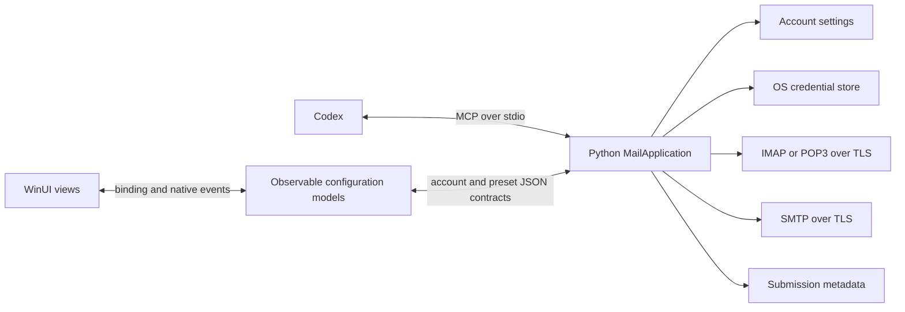

# Architecture

AgentInbox has one Python 3.11+ standard-library engine. `MailApplication` owns account policy and mail behavior; MCP, local management and the Windows WinUI 3 configuration app are adapters. See [validation](VALIDATION.md) for evidence tied to particular source snapshots.

## Boundaries

- Windows setup configures accounts, read/send permissions and the Codex connection. It checks connections and optionally one sample read; it does not send mail.
- MCP lists shared accounts, searches and reads mail, sends explicitly requested email and reads its status. It cannot configure accounts, retrieve credentials or enable sending. The client is responsible for interpreting the user's sending instruction; no second AgentInbox approval is required.
- IMAP selects folders read-only and uses non-marking reads. POP3 exposes one INBOX, no unread flags and header/date filtering; it sends no delete commands. Provider content is untrusted data.
- Windows presets select passwords/app passwords for Gmail and iCloud, and OAuth2 for Outlook.com and Microsoft 365. The desktop app loads the public Microsoft client ID from shipped `appsettings.json`; saved accounts keep the registration tied to their tokens. No Google OAuth, authentication fallback after failure, old command aliases or schema conversion.
- TLS or mandatory STARTTLS validates certificates and hostnames. Unsupported configuration fails without plaintext or weaker fallback.

## Configuration and checks

The Python contracts in `python/agentinbox/models.py` describe accounts, mail endpoints, sign-in choices and provider presets. `config.account_input` remains the runtime validation boundary. CLI and MCP both call `MailApplication`; they do not maintain different copies of account policy. The wire format and stored schema are unchanged.

Windows uses typed, non-secret records in `Models/AccountSettings.cs` for that same JSON contract. `ConfigurationModel` owns saved-account snapshots, selection, busy state and notices. `AccountEditorModel` owns the unsaved draft, provider defaults and field errors. It loads provider defaults from Python's existing `presets` operation. `MicrosoftSignInModel`, `AccountCheckModel` and `AssistantConnectionModel` own their operation progress and outcomes. These classes have no WinUI control references.

Views use native bindings for fields, choices, buttons, visibility, status and diagnostics. Native multi-selection events forward folder choices to the model because `ListView.SelectedItems` is not a bindable dependency property. Window ownership, layout, focus, browser launch and clipboard actions stay in the view adapter. The view does not read text boxes to build an account or decide its mail policy. Navigating to Connect Codex and back rebinds the same draft; explicit refresh, selection, save or cancellation changes that draft.

Schema 3 JSON contains non-secret settings, including optional `preset` metadata (`custom`, `gmail`, `icloud`, `outlook` or `microsoft365`). The desktop writes the chosen provider on save; readers neither infer nor backfill missing metadata. An unsupported preset fails validation. Windows Credential Manager holds passwords and Microsoft refresh tokens; current-user DPAPI protects temporary sign-in state. Native macOS Keychain and Linux Secret Service paths are source-only and untested.

Current-form `check_account` discovers folders and checks configured SMTP; optional `read_message` reads one bounded sample. `check_smtp` checks SMTP independently, without an incoming password, saved changes or sending permission. Both emit actual settings, TLS and authentication progress to the same owned Mica window. Test all checks saved snapshots sequentially without changing the editor draft, stops on failure or cancellation, and keeps successful check marks only in the current list session. It neither reads message content nor sends mail. Operation notifications use owned Mica result dialogs with selectable details; cleanup retry stays separate from the committed outcome. Provider favicons load from Google's favicon CDN using fixed provider domains, with a native mail-icon fallback when unavailable. Local failures can include bounded, redacted server details; MCP errors omit them. Saving is a separate commit, preserved if later UI refresh fails.

Source Windows profiles default to `%LOCALAPPDATA%\AgentInbox`; packaged processes share `%LOCALAPPDATA%\Packages\<package-family>\LocalState\AgentInbox`. An absolute `AGENTINBOX_DATA_DIR` overrides either. Account changes and sign-in can leave retired credential references in a cleanup queue. Cleanup failure is reported separately and never repeats the completed operation.

## Sending

`send_email` validates account permission and input, snapshots attachment bytes into in-memory MIME content, claims a caller-supplied request ID in SQLite and submits once. It checks the account revision again immediately before SMTP DATA. It does not store message content or create an approval queue.

The schema 4 ledger contains only request ID, account ID, timestamp, status and an optional safe error code. A unique primary key prevents duplicate IDs from submitting twice, including concurrent calls. Older ledgers fail explicitly and are not converted or deleted.

Outcomes are `accepted_by_server`, `rejected` or `outcome_unknown`. `submitting` means the request was claimed but no final result was recorded; a process may still be running or may have stopped. Status lookup never submits a message. A disk failure after submission returns the observed SMTP outcome with `status_recorded: false`. Acceptance never proves delivery, and unresolved outcomes are never retried automatically.

## Entry points

`python -B python/run.py mcp` serves MCP. `manage` handles one local JSON request; `manage --session` retains references for search followed by read. References expire and cannot cross process boundaries.

## State lifetime

Each `MailApplication` owns one `SessionState`; its Microsoft service uses that same object. It contains opaque message references, search continuations and short-lived access-token cache entries. Search references and continuations expire after ten minutes; each cache is trimmed to 1,000 entries before use. Session data is never serialized, and its diagnostic representation omits cache contents.

| State | Owner | Lifetime |
| --- | --- | --- |
| Saved accounts and read/send permissions | Python `Store` | Persistent JSON, read again by the engine when needed |
| Passwords and Microsoft refresh tokens | OS credential store | Persistent protected credentials |
| Active Microsoft device flow | Python Microsoft service and protected temporary store | Bound to account revision and expiry; accessible across management calls |
| Send outcomes and duplicate request IDs | Python `SendLedger` | Persistent SQLite metadata |
| Message references, search continuations and access-token cache | `SessionState` | One Python process |
| Unsaved Windows draft, selection, validation and operation presentation | Observable Windows models | One configuration window; never the source of saved engine permissions |

MCP requests are individual operations on a long-lived local process, so their temporary references survive between calls. Ordinary `manage` starts a fresh application and session for one request; `manage --session` reuses them for its input loop. Neither adapter introduces a global singleton or an extra background service. Persistent account revisions and request IDs still enforce concurrency and duplicate prevention across processes.

The MSIX bundles Python and registers the stable `AgentInbox.exe` alias. Installed clients use `-B -m agentinbox mcp`, with an explicit profile and no versioned package paths. The native executable opens configuration only. Linux and macOS have Python source, without a configuration GUI or commercial binaries.

See [tool contract](MCP_CONTRACT.md), [management CLI](CLI_REFERENCE.md), [Windows setup](WINDOWS_SETUP.md) and [packaging](../packaging/windows/README.md).
