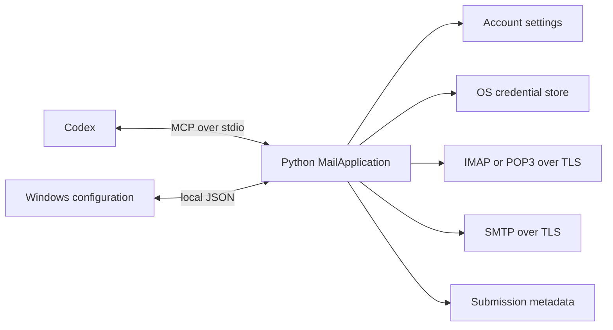

# Architecture

AgentInbox has one Python 3.11+ standard-library engine. `MailApplication` owns account policy and mail behavior; MCP, local management and the Windows WinUI 3 configuration app are adapters. See [validation](VALIDATION.md) for evidence tied to particular source snapshots.

## Boundaries

- Windows setup configures accounts, read/send permissions and the Codex connection. It checks connections and optionally one sample read; it does not send mail.
- MCP lists shared accounts, searches and reads mail, sends explicitly requested email and reads its status. It cannot configure accounts, retrieve credentials or enable sending. The client is responsible for interpreting the user's sending instruction; no second AgentInbox approval is required.
- IMAP selects folders read-only and uses non-marking reads. POP3 exposes one INBOX, no unread flags and header/date filtering; it sends no delete commands. Provider content is untrusted data.
- Windows presets select passwords/app passwords for Gmail and iCloud, and OAuth2 for Outlook.com and Microsoft 365. The desktop app loads the public Microsoft client ID from shipped `appsettings.json`; saved accounts keep the registration tied to their tokens. No Google OAuth, authentication fallback after failure, old command aliases or schema conversion.
- TLS or mandatory STARTTLS validates certificates and hostnames. Unsupported configuration fails without plaintext or weaker fallback.

## Configuration and checks

Schema 3 JSON contains non-secret settings. Windows Credential Manager holds passwords and Microsoft refresh tokens; current-user DPAPI protects temporary sign-in state. Native macOS Keychain and Linux Secret Service paths are source-only and untested.

Current-form `check_account` discovers folders and checks configured SMTP; optional `read_message` reads one bounded sample. `check_smtp` checks SMTP independently, without an incoming password, saved changes or sending permission. Both emit actual settings, TLS and authentication progress to the same owned Acrylic window. Local failures can include bounded, redacted server details; MCP errors omit them. Saving is a separate commit, preserved if later UI refresh fails.

Source Windows profiles default to `%LOCALAPPDATA%\AgentInbox`; packaged processes share `%LOCALAPPDATA%\Packages\<package-family>\LocalState\AgentInbox`. An absolute `AGENTINBOX_DATA_DIR` overrides either. Account changes and sign-in can leave retired credential references in a cleanup queue. Cleanup failure is reported separately and never repeats the completed operation.

## Sending

`send_email` validates account permission and input, snapshots attachment bytes into in-memory MIME content, claims a caller-supplied request ID in SQLite and submits once. It checks the account revision again immediately before SMTP DATA. It does not store message content or create an approval queue.

The schema 4 ledger contains only request ID, account ID, timestamp, status and an optional safe error code. A unique primary key prevents duplicate IDs from submitting twice, including concurrent calls. Older ledgers fail explicitly and are not converted or deleted.

Outcomes are `accepted_by_server`, `rejected` or `outcome_unknown`. `submitting` means the request was claimed but no final result was recorded; a process may still be running or may have stopped. Status lookup never submits a message. A disk failure after submission returns the observed SMTP outcome with `status_recorded: false`. Acceptance never proves delivery, and unresolved outcomes are never retried automatically.

## Entry points

`python -B python/run.py mcp` serves MCP. `manage` handles one local JSON request; `manage --session` retains references for search followed by read. References expire and cannot cross process boundaries.

The MSIX bundles Python and registers the stable `AgentInbox.exe` alias. Installed clients use `-B -m agentinbox mcp`, with an explicit profile and no versioned package paths. The native executable opens configuration only. Linux and macOS have Python source, without a configuration GUI or commercial binaries.

See [tool contract](MCP_CONTRACT.md), [management CLI](CLI_REFERENCE.md), [Windows setup](WINDOWS_SETUP.md) and [packaging](../packaging/windows/README.md).
