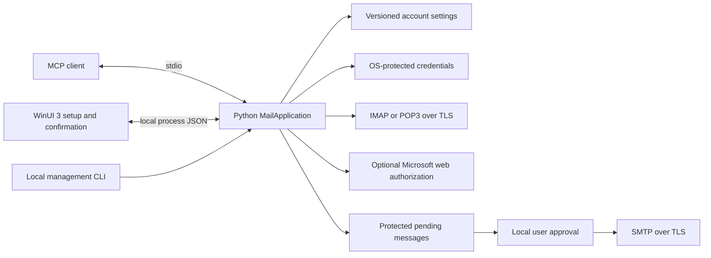

# Architecture

AgentInbox uses a Python 3.11+ engine for local MCP, account configuration, IMAP/POP3 reads and optional SMTP sends. The Windows app is a WinUI 3 client of that engine. The engine has no .NET backend and uses only the Python standard library.

The synthetic Python suite passes locally on Windows, and Debug MSIX 1.0.9.0 built and installed on Windows x64. Guided Codex configuration passed nine isolated checks. Account-form navigation, resizing, error recovery and packaged desktop startup were exercised with an isolated profile. Live providers, native credentials and packaged CLI/MCP entry points remain unvalidated. There is no compatibility layer or previous-profile importer. Unsupported configuration versions fail explicitly.

## Boundaries

- MCP and management adapters delegate to Python's `MailApplication`.
- MCP exposes account discovery, bounded message searches and reads, send preparation and send status. It cannot save credentials, enable sending or approve a message.
- WinUI 3 collects settings, runs requested connection checks and presents local review. It does not implement a second mail backend.
- Local `check_account` validates a current-form snapshot and discovers selectable folders without saving the draft or sending email. An explicit `read_message` choice tests one bounded message read and returns only its outcome, distinguishing an empty folder from a sample read. Opt-in management progress reports actual completed stages; the owned Mica window presents these records and returns explicit folder choices. Saving remains a separate commit, with its outcome preserved if later UI refresh fails. A test-email action opens the existing recipient, preview and approval flow after a confirmed save.
- Schema 3 JSON stores non-secret account settings, including incoming protocol and authentication choice. Passwords and tokens are protected separately; there are no older-schema aliases or import paths.
- Windows Credential Manager stores passwords and Microsoft refresh tokens. Current-user DPAPI protects temporary outgoing-message and sign-in blobs. macOS uses Keychain through native calls, and Linux requires an available Secret Service through native `libsecret` calls. These non-Windows paths remain untested. Missing or locked secure storage fails; no plain-text credentials file is allowed.
- IMAP uses read-only mailbox selection and non-marking retrieval. Mail content is untrusted data.
- POP3 sends no delete commands and presents one INBOX, without server folders or unread flags. Provider retention policies still apply. Search uses headers and the message Date header rather than server-received time.
- Password sign-in is the default. Optional Microsoft web authorization is selected explicitly and requires public-client registration settings. Local management handles sign-in with a short code; MCP cannot start it or receive its tokens. Web authorization is not available for Google accounts, and the method never changes automatically after failure.
- SMTP starts disabled and requires approval of each exact pending message.
- Connections require implicit TLS or required STARTTLS with certificate and hostname validation. There is no plaintext mode or custom-CA control. Unsupported settings and invalid schemas fail without a weaker fallback.
- Stdout contains protocol or management JSON. Diagnostics go to stderr and exclude credentials and message content.

## Local management and storage

`manage` handles one JSON request. `manage --session` retains one `MailApplication` until stdin ends, so a search reference or continuation can be used by later requests in the same process. These references are not transferable to another CLI process. `profile_info` reports the selected paths, schema and secure-storage facilities without returning secrets.

Windows source processes default to `%LOCALAPPDATA%\AgentInbox`. Packaged Python resolves its native package family and uses `%LOCALAPPDATA%\Packages\<package-family>\LocalState\AgentInbox`, matching the WinUI app. An absolute `AGENTINBOX_DATA_DIR` overrides both. Settings, the outgoing ledger and temporary protected files share that explicit profile; Credential Manager remains separate.

A persistent cleanup queue holds references to retired credentials, consumed sign-in state and terminal outgoing content. It does not hold their plaintext contents. A cleanup failure preserves the committed account, sign-in or send outcome and reports `cleanup_pending`, its count and a safe error. The UI shows cleanup separately and `retry_cleanup` retries the shared queue; it never repeats an email submission.

## Sending

Preparation freezes and protects the MIME message, including all recipients and attachment bytes. Local review displays that content. Approval is single-use; changing the content requires a new request.

Pending requests expire after ten minutes. Expired content is cleaned on subsequent access, not by a background timer. Local management lists the latest 100 outgoing records, including terminal states, so the UI can show accepted and uncertain outcomes. Source review can use a local tkinter window; Windows also has its native UI review path. Missing confirmation facilities must leave a request unsent.

The transport distinguishes acceptance, rejection and an uncertain outcome. It never automatically retries a message whose acceptance is unknown. Server acceptance is not evidence of recipient delivery.

## Source and packaging

Run `python -B python/run.py mcp` from source. Management uses `python -B python/run.py manage` with JSON on stdin, or `manage --session` for search followed by read. Local review uses the `review` command; see [CLI reference](CLI_REFERENCE.md).

The MSIX registers `AgentInbox.exe` as a stable alias to its bundled Python runtime. Installed commands use `AgentInbox.exe -B -m agentinbox <command>`. Exported MCP configuration uses the absolute alias path and explicit profile, without versioned package paths. Native review discovers the current installed desktop executable; requesting review does not approve the message.

Windows commercial distribution is MSIX only. Linux and macOS are source-only and unverified. See [tool contract](MCP_CONTRACT.md), [account settings](AUTHENTICATION.md), [dependencies](DEPENDENCIES.md) and [validation](VALIDATION.md).
