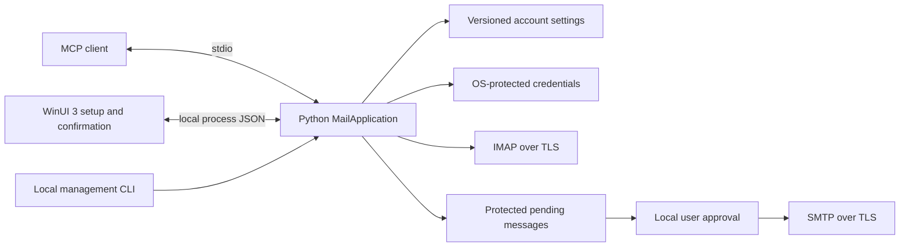

# Architecture

AgentInbox uses a Python 3.11+ engine for local MCP, account configuration, IMAP reads and optional SMTP sends. The Windows app is a WinUI 3 client of that engine. The engine has no .NET backend and uses only the Python standard library.

This source implementation is unvalidated. It has no compatibility layer or previous-profile importer. Unsupported configuration versions fail explicitly.

## Boundaries

- MCP and management adapters delegate to Python's `MailApplication`.
- MCP exposes account discovery, bounded message searches and reads, send preparation and send status. It cannot save credentials, enable sending or approve a message.
- WinUI 3 collects settings, runs requested connection checks and presents local review. It does not implement a second mail backend.
- Versioned JSON stores non-secret account settings. Passwords are protected separately.
- Windows uses DPAPI, macOS uses Keychain through native calls, and Linux requires an available Secret Service through native `libsecret` calls. Missing or locked secure storage fails; no plain-text credentials file is allowed.
- IMAP uses read-only mailbox selection and non-marking retrieval. Mail content is untrusted data.
- SMTP starts disabled and requires approval of each exact pending message.
- Plain-text connections, invalid certificates, unsupported sign-in methods and invalid schemas fail without a weaker fallback.
- Stdout contains protocol or management JSON. Diagnostics go to stderr and exclude credentials and message content.

## Sending

Preparation freezes and protects the MIME message, including all recipients and attachment bytes. Local review displays that content. Approval is single-use; changing the content requires a new request.

Pending requests expire after ten minutes. Expired content is cleaned on subsequent access, not by a background timer. Local management lists the latest 100 outgoing records, including terminal states, so the UI can show accepted and uncertain outcomes. Source review can use a local tkinter window; Windows also has its native UI review path. Missing confirmation facilities must leave a request unsent.

The transport distinguishes acceptance, rejection and an uncertain outcome. It never automatically retries a message whose acceptance is unknown. Server acceptance is not evidence of recipient delivery.

## Source and packaging

Run `python -B python/run.py mcp` for MCP. Management uses `python -B python/run.py manage` with JSON on stdin. Local review uses the `review` command; see [CLI reference](CLI_REFERENCE.md).

Windows commercial distribution is MSIX only. Linux and macOS are source-only and unverified. See [tool contract](MCP_CONTRACT.md), [account settings](AUTHENTICATION.md), [dependencies](DEPENDENCIES.md) and [validation](VALIDATION.md).
